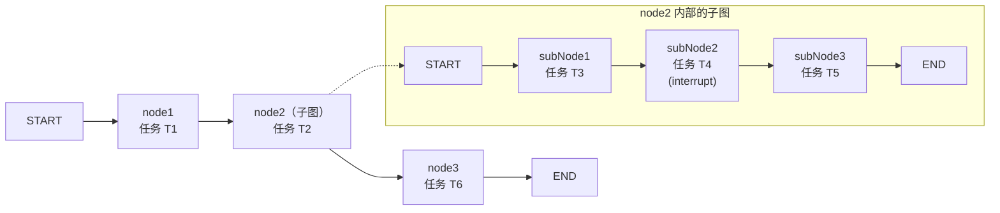

## 6.checkpoint=true底层解析

1. 三种ID说明

| 标识            | 含义                         |
| --------------- | ---------------------------- |
| `thread_id`     | 线程编号                     |
| 任务 ID         | 某个节点的一次执行任务的编号 |
| `checkpoint_id` | 检查点的编号                 |



<p align="center">图 1-1</p>

这里的`T1 T2...`就是任务ID,下面讲解都用这个图

2. `checkpoint=true`底层的变化

   父图节点保存没有namespace

   子图保存的时候有namespace

    - 默认配置: 子图的namespace 是 `node2:任务ID`,每次调用子图都会创建一个新的任务ID, 因此每次time travel都会形成新的`namespace`.

    - 开启`checkpoint=true`: 子图的namespace会去掉任务ID, 变为`node2`

   ```text
   默认配置                         checkpointer: true
   Node2
   ├─ Node2:111（第一次调用）        └─ Node2
   │  ├─ 检查点1                       ├─ 检查点1（第一次调用）
   │  └─ 检查点2                       ├─ 检查点2（第一次调用）
   └─ Node2:222（第二次调用）           ├─ 检查点3（第二次调用）
      ├─ 检查点3                       └─ 检查点4（第二次调用）
      └─ 检查点4
   ```

   检查点通过以下组合定位：

   ```text
   thread_id + checkpoint_ns + checkpoint_id
   哪个线程     哪组存档          哪份存档
   ```

   默认配置下每个checkpoint仍有自己的 ID. 因此仍能实现interrupt。但不能实现 fork或replay。

   因为重新调度时子图的命名空间会发生变化，因此找不到checkpoint。从而无法执行

### Time Travel到底发生了什么？

假定当前的checkpoint ID是C1，namespace是`Node2: T1`。

1. 调用`updateState()`修改`checkpoint`, 这一步会创建一个新的`checkpoint`ID为`C2`, 存在`Node2:T1`下
2. 将新创建的config 传给 `invoke()`，从新 checkpoint 继续执行：
3. 父图为Node2创建新的父checkpoint, 生成新的 `taskId T2`。
4. 根据`T2`, 得到子图的新namespace: `Node2:T2`
5. 在 `Node2:T2`中寻找`checkpoint C2`, 发现找不到, 因此子图重新执行。
6. 如果设置了 `{checkpointer: true}`，那么namespace将一直是 node2。这样就能找到新创建的C2, 从而继续执行